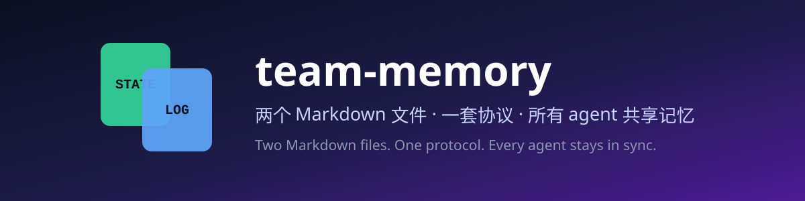
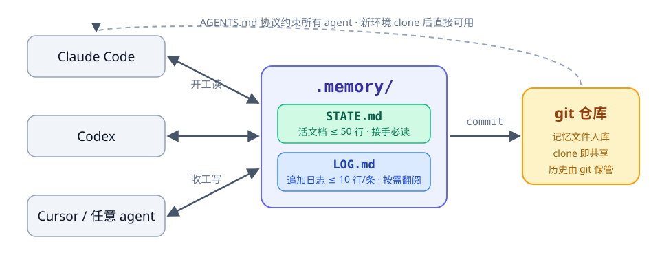

<div align="center">
  <p>
    
  </p>
  <p>
    <a href="LICENSE"></a>
    <a href="#3-快速开始"></a>
    <a href="#4-工作机制"></a>
    <a href="README_EN.md"></a>
    <a href="https://github.com/sdh0219/team-memory/stargazers"></a>
  </p>
  <p>
    <a href="#3-快速开始">快速开始</a>
    · <a href="#4-工作机制">工作机制</a>
    · <a href="#5-协议原文">协议原文</a>
    · <a href="examples/">示例</a>
    · <a href="docs/faq.md">FAQ</a>
    · <a href="README_EN.md">English</a>
  </p>
</div>

---

**team-memory** 让一群 agent 接力干同一个项目时不再互相失忆：每个 agent 开工只读一个
50 行以内的状态文件就能接上进度，收工时留一条 10 行以内的蒸馏日志。协议写进
`AGENTS.md`，所以**不装任何东西的 agent 也会遵守**。零服务器、零向量库，git 原生。

## 目录

- [1. 这是什么](#1-这是什么)
- [2. 为什么是文件，不是记忆服务](#2-为什么是文件不是记忆服务)
- [3. 快速开始](#3-快速开始)
- [4. 工作机制](#4-工作机制)
- [5. 协议原文](#5-协议原文)
- [6. 示例](#6-示例)
- [7. 文档](#7-文档)
- [8. 贡献](#8-贡献)
- [9. Star 历史](#9-star-历史)
- [10. 许可](#10-许可)

## 1. 这是什么



三个角色，各司其职：

- **`.memory/STATE.md`** — 当前状态的活文档，直接改写永不追加，全文 ≤ 50 行，接手者只读它就能接上
- **`.memory/LOG.md`** — 追加式交接日志，最新在上，每条 ≤ 10 行，只在需要历史细节时翻
- **`AGENTS.md` 协议段** — 让所有 agent（装没装 skill 的都算）自动遵守同一套读写纪律

按记忆分层的说法：STATE.md 是工作记忆（热层），LOG.md 是情景记忆（冷层），AGENTS.md
协议是语义记忆（规则层）——两个 Markdown 文件加一段协议，就是一套完整的分层记忆。

记忆文件随仓库进 git——克隆即共享，这是所有 agent 天生就能读写的唯一存储。

本仓库正在生长为 `team-*` 技能家族：`team-memory` 管记忆——下一个 agent 怎么接手；`team-digest`
管蒸馏——项目主人怎么看进度（把 LOG + git log 蒸馏成周报/日报）。安装脚本会把 `skills/`
下所有成员一并装好，后续新成员自动纳入。

## 2. 为什么是文件，不是记忆服务

| | team-memory | MemOS / mem0 / Letta |
|---|---|---|
| 形态 | 仓库里两个 Markdown 文件 | 数据库 + 服务 + SDK |
| 依赖 | 只要会用 git | 部署、运维、API key |
| 跨工具 | 天然共享（所有 agent 都会读写文件） | 需要逐个接入 |
| 记忆规模 | 一个项目的交接结论 | 海量长期记忆 |
| 适合 | 个人 / 小团队的多 agent 接力协作 | 产品级海量会话记忆 |

重方案解决的是"海量记忆怎么存取调度"；team-memory 解决的是更常见的那件事——
**下一个 agent 怎么花最少的 token 接上进度**。光谱两端，不冲突，还能互相喂种子数据。

## 3. 快速开始

### 3.1 脚本安装（推荐）

```bash
git clone --depth 1 https://github.com/sdh0219/team-memory
cd team-memory
bash scripts/install.sh           # 装到全部三个技能目录
bash scripts/install.sh --zcode   # 或只装某一个：--zcode / --agents / --claude
```

Windows（PowerShell）：

```powershell
git clone --depth 1 https://github.com/sdh0219/team-memory
cd team-memory
powershell -File scripts\install.ps1              # 默认全部
powershell -File scripts\install.ps1 -Target zcode # 或指定：zcode / agents / claude
```

装好后对 agent 说一句「给这个项目初始化 team-memory 记忆层」即可。

对 agent 说「生成本周项目周报」可触发家族成员 team-digest——它把 LOG 和 git log 蒸馏成进度报告，对记忆文件只读。

### 3.2 手动安装

把 `skills/team-memory/` 整个目录复制到你 agent 的技能目录
（`~/.zcode/skills/`、`~/.agents/skills/` 或 `~/.claude/skills/`）。

### 3.3 不装 skill，只取协议

把 [协议原文](#5-协议原文) 粘进项目的 `AGENTS.md`，再照
[examples/](examples/) 建两个记忆文件就行——协议本身不依赖任何工具。

## 4. 工作机制

`.memory/` 下两个文件，分工明确：

| 文件 | 角色 | 规则 |
|---|---|---|
| `STATE.md` | 当前状态的活文档 | 直接改写、永不追加，全文 ≤ 50 行 |
| `LOG.md` | 追加式交接日志 | 最新在最上，每条 ≤ 10 行 |

收工时往 `LOG.md` 顶部写一条：

```
## 2026-10-25 21:40 · Codex
- 做了：微信支付回调验签打通，notify_url 能正确落库
- 改动：pay/wechat/callback.py、tests/test_wechat_callback.py
- 遗留：退款流程未动；验签密钥走环境变量 WECHAT_PAY_KEY，别写死
```

四条纪律撑起整个协议：**STATE 改写不追加，LOG 只追加不修改，细节进 commit message，
「正在做」两周没动就更新或回退**。
完整规范见 [docs/protocol.md](docs/protocol.md)。

协议之外还有两个官方工具帮记忆保鲜：

```bash
python scripts/validate_memory.py   # 校验 .memory/：行数上限、小节完整、日期顺序、密钥泄露
python scripts/archive_log.py       # LOG 超过 100 条自动归档到 LOG-archive.md
```

建议收工前或 CI 里跑一下 validate——纪律会松，工具不会。

## 5. 协议原文

把这段放进项目 `AGENTS.md`（skill 初始化时也会自动写入）：

```markdown
## Agent 记忆协议（每个会话必做）

开工前：
1. 读 .memory/STATE.md（必读，很短）
2. 仅当任务需要历史细节时，再查 .memory/LOG.md 和 git log --oneline -15

收工前（阶段性工作结束）：
1. 更新 .memory/STATE.md：完成项移出"正在做"，更新"下一步"
2. 在 .memory/LOG.md 顶部追加一条记录（日期/agent 名/结论/改动文件/遗留），≤ 10 行

纪律：STATE.md 直接改写不追加；LOG.md 只追加；细节写进 commit message；
「正在做」两周没动就更新或回退；不把密钥、token 等敏感信息写入记忆文件。
```

## 6. 示例

[examples/](examples/) 里有一个真实感完整示例：一个 Web 项目的
[AGENTS.md](examples/AGENTS.md)、[STATE.md](examples/memory/STATE.md) 和
[LOG.md](examples/memory/LOG.md)，照着抄就是了。

## 7. 文档

- [协议规范](docs/protocol.md) — 两个文件的完整定义、字段表、反模式清单（[English](docs/protocol_EN.md)）
- [常见问题](docs/faq.md) — 污染历史？并发写？和自带记忆的区别？agent 不听话怎么办？（[English](docs/faq_EN.md)）

## 8. 贡献

欢迎 issue 和 PR。改 `skills/team-memory/SKILL.md` 的协议内容时，请同步更新
两个 README 和 docs 里的协议原文，保持四处一致。

## 9. Star 历史

[](https://star-history.com/#sdh0219/team-memory&Date)

## 10. 许可

[MIT](LICENSE)
